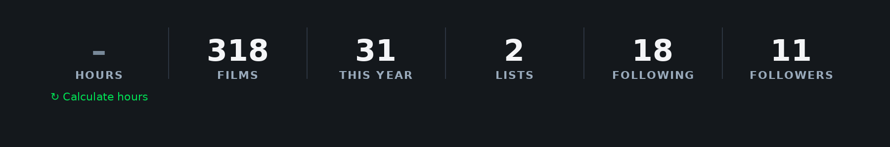
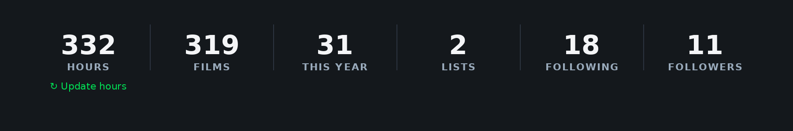

# Letterboxd Hours

See how many **hours** anyone has spent watching films on Letterboxd.

This browser extension adds an **HOURS** counter to every Letterboxd profile, right next to **FILMS**, styled like the native stats.


---

## Install (2 minutes, no coding)

You don't need Node, git or the code. Just the zip.

1. **Download** [`letterboxd-hours-v1.0.0.zip`](https://github.com/iagoesteevezz/letterboxd-hours-extension/releases/latest) from the latest release (under **Assets**).
2. **Unzip it.** Right click, Extract all. You get a folder called `dist`.
3. Open **`chrome://extensions`** in Chrome (Edge: `edge://extensions`, Opera: `opera://extensions`).
4. Turn on **Developer mode** (toggle at the top right in Chrome and Opera, left sidebar in Edge).
5. Click **Load unpacked**.
6. Select the **`dist`** folder you unzipped (the one that has `manifest.json` inside) and confirm.

Done. "Letterboxd Hours" now shows in your extensions list.

**Problems?**
- *"Manifest file is missing or unreadable"*: you picked the wrong folder. Pick the `dist` folder that contains `manifest.json`, not the zip and not a parent folder.
- *No HOURS counter*: refresh the Letterboxd tab after installing.
- *Don't move or delete the `dist` folder* after loading it. Chrome reads the extension from there.
- Chrome may show a "Disable developer mode extensions" notice on startup. You can dismiss it.

---

## How to use it

Open any profile, for example `https://letterboxd.com/iagoesteevezz/`, and click **Calculate hours** once.

| You see | What it means | What to do |
|---|---|---|
| **Calculate hours** | First time on this profile | Click it once |
| **Calculating… 12/40** | It's working | Wait |
| A number (e.g. `332`) | Saved and up to date | Nothing, it's instant |
| A number + **Update hours** | You watched new films | Click to add only the new ones |
| A number + **Finish calculation** | A run was interrupted | Click, it resumes where it stopped |

The first calculation on a big profile takes a while. After that, every visit is instant.

Demo, first calculation:



Demo, updating after watching new films:



---

## Features

- HOURS stat on any Letterboxd profile, next to FILMS
- Looks native: it copies Letterboxd's own styling
- Saves the result, so it never repeats work
- Update mode: only fetches new films and adds them to the total
- Resumes if you reload the page halfway
- Polite to Letterboxd: limited, spaced-out requests
- English and Spanish interface (follows your browser language)
- No account, no tracking, no data leaves your browser. The only permission besides `letterboxd.com` is local storage.

## Browser support

| Browser | Works |
|---|---|
| Chrome | Yes |
| Edge | Yes |
| Opera / Brave and other Chromium browsers | Should work, same steps |
| Firefox / Safari | Not yet |

It uses Manifest V3.

## How it works

Letterboxd has no public API, so the extension reads the public pages:

1. Reads your **FILMS** count from the profile.
2. Collects the list of watched films.
3. Opens each film page once to read its runtime and adds them up.
4. Saves the result.

Films with no published runtime count as 0 minutes. If Letterboxd changes its page layout, the counter may break until the parsers are updated.

---

## Build from source (developers)

Needs Node.js 18 or newer.

```bash
git clone https://github.com/iagoesteevezz/letterboxd-hours-extension.git
cd letterboxd-hours-extension
npm install
npm run build      # outputs to dist/
```

Then load `dist/` with **Load unpacked**, same as above.

```bash
npm run watch       # rebuild on save
npm run typecheck   # types only
```

After a rebuild, click the reload icon on the extension card in `chrome://extensions`.

### Project layout

```
├── build.mjs            # compiles src/ to dist/
├── public/              # manifest.json (MV3) and icons
└── src/
    ├── content.ts       # injects the HOURS box and handles the UI
    ├── background.ts    # page reading and caching
    ├── parser.ts        # extracts slugs and runtimes from HTML
    ├── rateLimiter.ts   # request throttle
    ├── storage.ts       # save/load helpers
    ├── i18n.ts          # UI strings (en, es)
    └── types.ts
```

### Tuning the speed

In `src/background.ts`:

```ts
const CONCURRENCY = 6;    // film pages fetched at once
const DELAY_MS    = 250;  // pause between requests (ms)
```

Higher is faster but pushier. If you see `HTTP 429` in the service worker console, lower them.

### Reset saved data

Open `chrome://extensions`, click **service worker** on the extension card, and run:

```js
chrome.storage.local.clear()
```

---

Made by [Iago Estévez](https://github.com/iagoesteevezz). Issues and PRs welcome.
